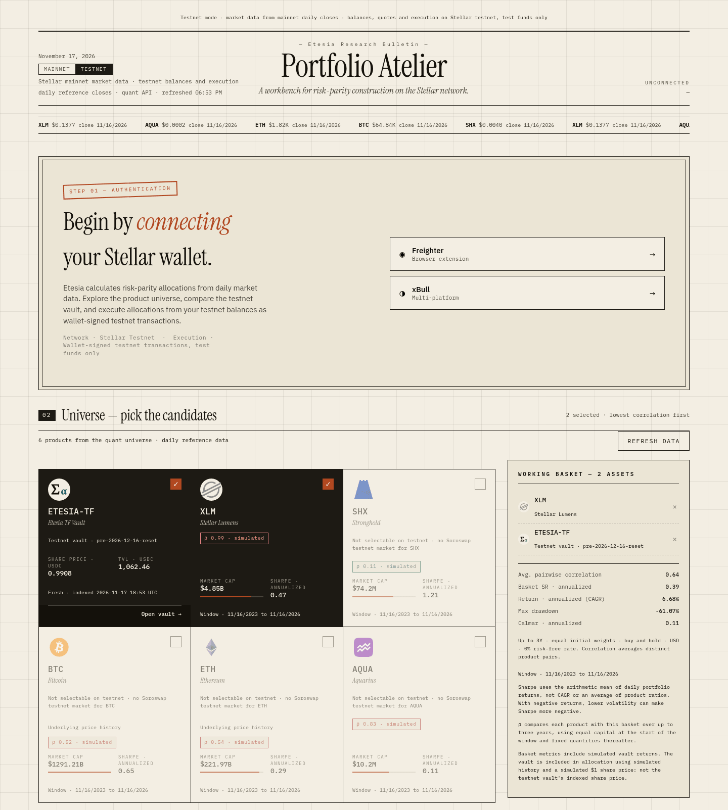
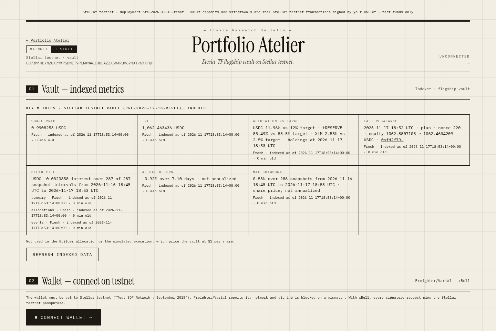

# Etesia Portfolio Builder

A web app for building a risk-balanced portfolio of Stellar assets and Etesia-TF, a trend-following vault on Stellar. It also has a vault page for deposits, withdrawals and indexed vault metrics, and a strategy factsheet.

Live on testnet: https://portfolioatelier.etesiar.com/?network=testnet

Vault contracts, testnet deployment and transaction archive: https://github.com/Etesia-Research/stellar_vault



*Portfolio Builder in testnet mode: the product universe with the Etesia-TF testnet vault and XLM selected, and the working basket's correlation and risk metrics.*

## Try it on testnet

No login or credentials are needed, only Freighter or xBull set to Testnet, with test XLM from Friendbot (Freighter offers it when the account is new).

1. Open https://portfolioatelier.etesiar.com/stellar_tf_vault/testnet and connect your wallet.
2. Click "Sign & add USDC trustline".
3. Go to https://portfolioatelier.etesiar.com/?network=testnet and select XLM and ETESIA-TF.
4. Under Funding, pick your XLM and set its amount to 500 XLM. Set the risk cap to 10% and keep the USTRY reserve.
5. Click "Build risk-parity portfolio", review the legs, then "Sign and execute". Approve each transaction in your wallet.
6. Return to the vault page. Your shares appear under Position. Try a deposit and a partial withdrawal: "Preview", then sign.

A build is capped at 100 USDC, and a swap that would move the pool price by more than 2% is blocked. Both limits protect the small testnet pools. Every receipt links to Stellar Expert.

The full manual scripts, with the expected page text, are in [docs/testnet-walkthrough.md](docs/testnet-walkthrough.md).

## What it does

- Lists Stellar assets and the Etesia-TF vault with daily prices, market caps, Sharpe ratios and correlations from the Etesia quant service.
- Shows return, Sharpe, drawdown and correlation for the selected basket.
- Takes wallet holdings as funding, a risk cap and a cash reserve, and returns a risk-balanced allocation with a three-year historical simulation.
- Executes or simulates that allocation, depending on the network (see the table).
- On testnet, shows the vault's share price, TVL, NAV and allocation history, performance, Blend yield and rebalance events, read from the Etesia indexer ([screenshots](docs/testnet-walkthrough.md#what-the-vault-page-shows)).

| | Testnet | Mainnet |
|---|---|---|
| Wallets (Stellar Wallets Kit) | Freighter, xBull | Freighter, Albedo, xBull, Lobstr Vault, HOT Wallet |
| Products you can allocate | XLM, Etesia-TF | XLM, AQUA, ETH, BTC, SHX, Etesia-TF |
| Cash reserves | USDC, and USTRY through its stand-in tRESERVE | USDC, EURC, USTRY |
| Builder execution | Wallet-signed transactions: trustlines, Soroswap swaps, vault deposit, withdrawal or redemption | Simulated with quotes; nothing is signed |
| Vault page | Live: deposit, withdraw, indexed metrics | Not deployed |

Market data comes from mainnet daily closes on both networks.



*Etesia-TF testnet vault: indexed share price, TVL, allocation against target, last rebalance, Blend yield, return and drawdown.*

## Pages

| Route | Page |
|---|---|
| `/` | Builder, mainnet mode |
| `/?network=testnet` | Builder, testnet mode |
| `/stellar_tf_vault/testnet` | Vault page on testnet; `?amount=<USDC>` prefills a deposit |
| `/stellar_tf_vault/mainnet` | Vault page on mainnet, shown as not deployed |
| `/stellar_tf_vault` | Etesia-TF strategy factsheet; no wallet needed |
| `/testnet` | Redirects to `/stellar_tf_vault/testnet` |

## Run locally

Requires Node 22.12 or later and pnpm. Copy `.env.example` to `.env.local` and fill in these server-only variables:

| Variable | Used for |
|---|---|
| `ETESIA_API_URL` | Base URL of the Etesia quant service |
| `ETESIA_API_KEY` | Every quant service call except the testnet liquidity top-up |
| `ETESIA_LIQUIDITY_API_KEY` | The quant service's testnet liquidity top-up |
| `SOROSWAP_API_KEY` | Testnet swap quotes and builds from the Soroswap API |

```sh
pnpm install --frozen-lockfile
pnpm dev
pnpm exec node --test tests/*.test.cjs
pnpm build
pnpm exec tsc --noEmit
```

`tests/` holds 164 tests in 11 files.

The app has two server proxies. `/api/quant` forwards an allowlist of paths to the Etesia quant service. `/api/soroswap` is a testnet-only quote and build proxy to the Soroswap API.

Keys never reach the browser. On testnet the wallet signs each transaction and the browser submits it: trustlines through Horizon, swaps and vault calls through Stellar RPC.

## Code map

| Path | Purpose |
|---|---|
| `app/page.tsx`, `components/PortfolioBuilder.jsx` | Builder: catalog, basket, funding, reserves, allocation |
| `components/TestnetExecution.jsx`, `lib/execution.ts` | Testnet legs, the 100 USDC cap and the 2% price impact limit |
| `components/ExecutionSimulation.jsx` | Mainnet simulated execution |
| `app/[vault]/[network]/page.tsx`, `components/VaultDesk.jsx` | Vault pages: indexed metrics, trustline, deposit, withdraw |
| `app/stellar_tf_vault/page.tsx` | Strategy factsheet |
| `app/api/quant/`, `app/api/soroswap/` | Server proxies |
| `lib/network.ts`, `lib/vaults.ts`, `lib/vault.ts` | Network settings, vault registry, vault contract client |
| `components/stellar/walletKit.ts` | Stellar Wallets Kit setup and network checks |
| `data/testnet-manifest.json` | Testnet deployment manifest |

## Related

- `data/testnet-manifest.json` is a copy of `deploy/testnet/pre-2026-12-16-reset.json` in [stellar_vault](https://github.com/Etesia-Research/stellar_vault).
- The Etesia quant service (allocation, indexer, metrics API) is a separate private service.

## More detail

- [docs/testnet-walkthrough.md](docs/testnet-walkthrough.md): manual testnet scripts with the expected page text.
- [docs/data-and-allocation.md](docs/data-and-allocation.md): data sources, allocation, simulation, execution and the factsheet.

## License

Copyright (c) 2026 Etesia Research Inc. All rights reserved. The source is published for inspection under the [Proprietary Source Inspection License](LICENSE).
