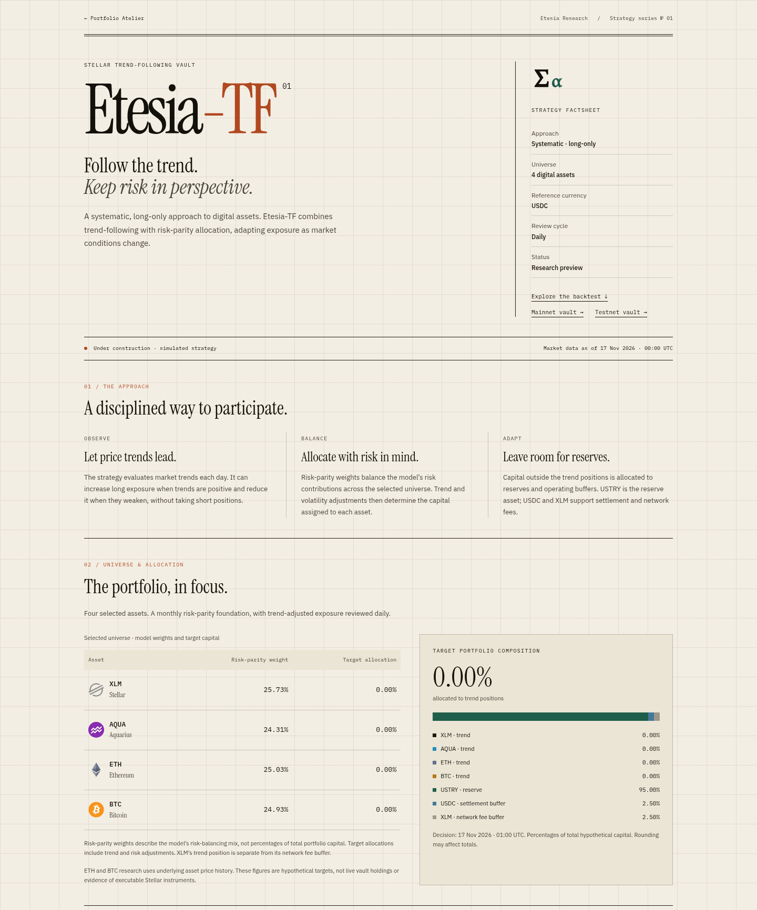

# Data and allocation

How the Builder gets its data, builds an allocation, simulates it and executes it, and what the Etesia-TF factsheet shows.

Statements that hold on one network only are marked **Mainnet** or **Testnet**. The rest hold on both.

## Products and prices

- Product cards come from the quant service's catalog: XLM, AQUA, ETH, BTC, SHX and the Etesia-TF vault.
- USDC, EURC and USTRY are reserve assets. They are not in the product grid.
- **Testnet**: only XLM and the Etesia-TF vault are selectable. AQUA, ETH, BTC and SHX read "Not selectable on testnet · no Soroswap testnet market for …".
- Prices are dated daily USD closes, not live swap marks. Market data comes from mainnet daily closes on both networks.
- The price band shows the completed candle day: a close stamped at midnight UTC is labeled with the day before.
- Market caps, annualized Sharpe over up to three years and correlations come from the quant service.
- Each card and the basket show their analytics window, from the first to the last candle date.
- Missing values stay unavailable. There is no static fallback and no allocation solver in the browser.
- ETH and BTC analytics use the underlying asset price histories.
- Product icons are served locally; see [logo sources](../public/logos/README.md).

## Basket analytics

- The working basket shows the average signed pairwise correlation (distinct pairs only), and annualized return (CAGR), Sharpe, maximum drawdown and Calmar.
- All of these come from one `POST /v1/basket/analytics` response.
- The basket starts with equal capital per selected product and holds the quantities fixed.
- It covers up to three years of common history (at least one year), in USD, at a 0% risk-free rate.
- Funding, reserves and allocation weights do not change these metrics.
- A single product's correlation, or missing data, shows an em dash with a reason.
- The vault's returns are simulated and labeled as such.

## Funding and risk cap

- Funding lists the wallet's holdings from Horizon balances. **Testnet** also lists tRESERVE and the vault shares.
- Several holdings can be selected as sources. Each starts at MAX. Its amount can be typed in its units or as a USDC value, or set with 25%, 50%, 75% or MAX. A typed amount must be above 0 and at most the maximum, with at most the asset's decimals.
- **Mainnet**: the USDC capital is the sum over the selected parts of `quantity × source USD close / USDC USD close`, with fresh matching timestamps.
- **Mainnet**: the displayed catalog value is a daily reference estimate, not full-wallet NAV.
- **Testnet**: the parts are valued at testnet Soroswap quotes to USDC and at the vault's share value.
- **Testnet**: the XLM maximum keeps back what a run needs for fees and the account reserve.
- **Testnet**: a build uses at most 100 USDC of the selected value. A larger selection is scaled down proportionally.
- The **Risk cap** slider defaults to 25% on mainnet and 15% on testnet; switching networks resets it. It is sent as the annual volatility budget of the allocated products.
- The risk cap does not change the reserve and buffer fractions, and it does not promise a realized portfolio volatility.

## Cash reserve

- **Cash reserve** comes after Funding. USTRY is selected by default.
- Select USDC, EURC and/or USTRY to split the residual cash equally by USDC notional.
- The 2.5% USDC and 2.5% XLM buffers are separate from this selection.
- EURC uses aligned EURC/USD and USDC/USD closes and is reserve-only.
- EURC is Circle's asset, from [Circle's published Stellar issuer](https://developers.circle.com/stablecoins/eurc-contract-addresses). Its issuer and mainnet asset contract are in `lib/assets.ts`.
- **Testnet**: the USTRY reserve is held as tRESERVE, an Etesia-issued stand-in. The EURC reserve is not selectable.

## Allocation

- The quant service builds a risk-parity allocation. It balances modeled risk contributions; it does not maximize historical Sharpe.
- The response gives target quantities, USDC notionals, reserve positions, the annual volatility of the allocated products, and the binding constraints.
- The page lists the binding constraints as "Model limits". A blocked calculation keeps its diagnostics.
- Product weights are scaled down together so that no non-vault product exceeds 40% of portfolio capital; the vault is exempt. The remainder goes to the reserves.
- When the 95% gross allocation cap binds, no residual cash is left for the reserve, and the page explains why.
- A selected vault enters the allocation through its simulated equity history, sized at a simulated $1 per share.
- The allocation and the historical simulation keep the vault's `vault_run_id`. A change of report requires a rebuild.
- Allocation totals include the vault.
- The preview labels the product allocation and the estimated annual product volatility separately. That estimate uses a one-year risk model and excludes reserves and buffers.
- Quotes appear only after allocation. Product and reserve selection, and the allocation itself, do not depend on quotes.

## Historical simulation

- After allocation, one `POST /v1/builder/simulation` request returns CAGR, Sharpe, annualized volatility, maximum drawdown and Calmar.
- It also returns the portfolio and XLM equity curves. Both start at 100, in USD.
- Today's weights, including buffers and reserves, are applied over the trailing three years.
- Each allocation stays in USD cash at 0% until its asset's first available close, then buys and holds without rebalancing.
- Later start dates are shown. All metrics use the full curve.
- This is a retrospective illustration and excludes trading costs.
- Sharpe is the arithmetic mean of daily returns divided by their sample standard deviation, times √365, at a 0% risk-free rate. CAGR divided by volatility is not the displayed Sharpe.
- The one-year risk-model estimate and the three-year historical volatility use different windows, weights and scopes, and are labeled separately.
- Internal gaps, stale tails, missing history or a changed market snapshot show an explicit unavailable state.

## Execution: mainnet simulation and testnet transactions

### Mainnet: simulated

- **Simulate execution** nets the selected sources against the model targets, valued at the daily close.
- The quotes come from the quant service through `/api/quant`. No Soroswap key is used on mainnet.
- A source above its target sells the excess to USDC. A position below its target buys from USDC.
- The sells are quoted first. The buys spend only the USDC those quotes return at least, scaled down together when short.
- A difference under 0.01 USDC is not traded. Rounding dust stays in the USDC buffer. Cash is kept without a swap.
- The vault needs no swap quote: shares are sized at $1, using the reference USDC/USD conversion.
- Each row shows the quoted output, the minimum output and the quote time. A failed quote, or one older than 60 seconds, blocks the simulation.
- Refresh fetches a new complete quote set and clears any earlier completion.
- No wallet signature, transaction, receipt hash or balance change occurs. Network and vault fees are excluded; fills are assumed at the quoted outputs.

### Testnet: wallet-signed transactions

- The Builder executes the allocation as one wallet-signed transaction per leg: trustlines, Soroswap swaps and the vault deposit, withdrawal or redemption.
- Sells run before buys, and only the selected holdings are traded.
- Swaps are quoted and built by the Soroswap API through `/api/soroswap`. It accepts only testnet manifest assets and forces the Soroswap venue and a 0.5% slippage.
- The browser submits swaps and vault calls through Stellar RPC, and trustlines through Horizon.
- Vault calls are bounded at 0.5% against their preview.
- A swap above the 2% price impact limit cannot be signed. The limit is checked again with fresh quotes before the first signature.
- Before quoting, the Builder asks the quant service's testnet liquidity top-up for the run's swaps. A failed request does not block the run.
- The steps and the page text are in [testnet-walkthrough.md](testnet-walkthrough.md).

## Etesia-TF factsheet

*Etesia-TF strategy factsheet: the approach, the four-asset risk-parity universe and the current target composition.*

- `/stellar_tf_vault` is a public strategy factsheet. It needs no wallet. The mainnet vault page links it as "Strategy factsheet and simulated backtest".
- It shows the fixed XLM, AQUA, ETH and BTC universe, the monthly risk-parity weights, and the daily target allocation including reserves and buffers.
- It also shows the latest published backtest metrics.
- The text describes the approach without formulas or calibration parameters. Allocations and performance are labeled as simulated.
- The server reads `vault/weights` and `vault/backtests/latest` from the quant service, without exposing their full research payloads.
- Missing or blocked allocations stay unavailable. The report loads on its own; a stale report keeps its dates and a warning.
- The PDF and XLSX downloads use `/api/quant/vault/backtests/{run_id}/files/{pdf|xlsx}`. Both refer to the displayed run.
- That GET-only proxy checks the 20-character hexadecimal run id and the format, streams the original file, and keeps the key server-side.
