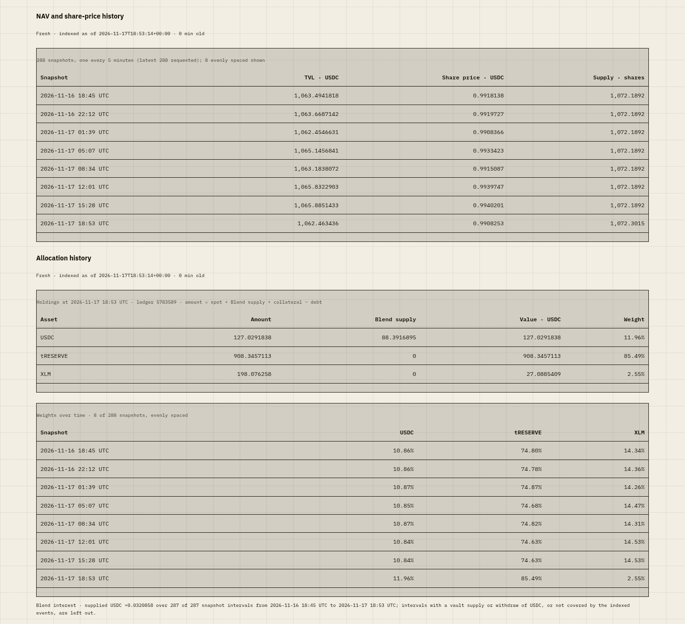
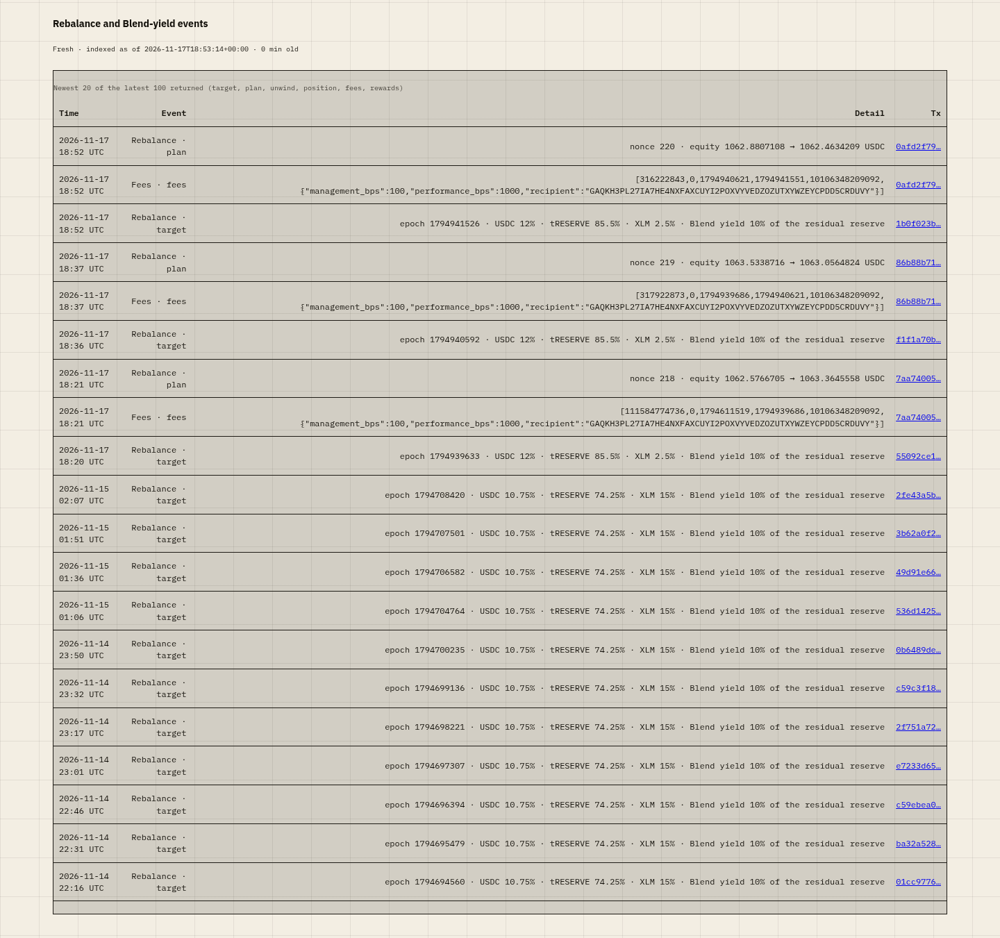

# Testnet walkthrough

Three manual scripts for the hosted app on Stellar testnet: the wallet check, the vault deposit and withdrawal, and the Builder's allocation and rebalance run.

Each step lists what the page should show. Quoted text is the exact page text; `…` stands for a value that changes.

Hosted app: https://portfolioatelier.etesiar.com. Paths below are relative to it.

## Before you start

- Use a throwaway testnet account funded with Friendbot.
- Set Freighter or xBull to Testnet.
- Test USDC comes from Blend's testnet faucet, https://testnet.blend.capital. The vault page links it once the USDC trustline exists.

## 1. Wallet check

1. Open `/stellar_tf_vault/testnet`, press **Connect wallet**, pick Varial (the wallet list's entry for Freighter) and approve.

   You should see:
   - "CONNECTED — Freighter" in the masthead.
   - "Funded · … XLM" and "USDC trustline Missing" under Onboarding.

2. Press **Sign & add USDC trustline** and reject the request in the wallet.

   You should see:
   - "Signature request was rejected in the wallet. Nothing was submitted."

3. Press **Sign & add USDC trustline** again and approve.

   You should see:
   - A receipt "Stellar testnet transaction, not a simulation · Add USDC trustline" with the ledger and hash.

4. With Freighter, switch the wallet to Mainnet, then return to the tab. xBull does not report its network, so steps 4 and 5 do not apply to it.

   You should see:
   - The banner "Wallet network mismatch: switch your wallet to Stellar testnet …".
   - The sign buttons disabled.

5. Switch the wallet back to Testnet and return to the tab.

   You should see:
   - The banner cleared.

6. Press **↪ disconnect**.

   You should see:
   - "UNCONNECTED" in the masthead.

## 2. Vault deposit and withdrawal

Same page, wallet connected, USDC trustline present.

1. Claim test USDC from the Blend faucet link, then press **Refresh**.

   You should see:
   - "USDC trustline Present · … USDC".

2. Under "① Deposit USDC", enter an amount and press **Preview**.

   You should see:
   - "Simulation preview · … USDC ≈ …; minimum accepted … (0.5% bound)".

3. Press **Sign & deposit** and approve.

   You should see:
   - A receipt with the shares the contract returned.

4. Under "② Partial withdraw", enter an amount within "Max withdraw", press **Preview**, then **Sign & withdraw** and approve.
5. Press **Sign & redeem all shares** and approve.

   You should see, after each of steps 4 and 5:
   - A receipt "Stellar testnet transaction, not a simulation · …" with the ledger and hash.

If a transaction cannot be confirmed, the page gives its hash and reads "Its outcome is unknown; check the explorer before retrying."

## 3. Allocation and rebalance run

Same wallet setup, with test USDC from the Blend faucet.

### Open the testnet Builder

1. Open `/?network=testnet`.

   You should see:
   - The banner "Testnet mode · market data from mainnet daily closes · balances, quotes and execution on Stellar testnet, test funds only".
   - The AQUA, ETH, BTC and SHX cards read "Not selectable on testnet · no Soroswap testnet market for …" and ignore clicks.

2. Connect the wallet.

   You should see, under "① Your holdings — select the sources to allocate or rebalance", each asset only when held:
   - XLM, with "MAX keeps … XLM back for fees and the account reserve".
   - USDC.
   - tRESERVE, "USTRY stand-in on testnet".
   - ETESIA-TF, "Vault shares · … USDC".

   Under the cash reserve:
   - The EURC reserve reads "Not selectable on testnet · no Soroswap testnet market for EURC".
   - The USTRY reserve reads "USTRY stand-in on testnet: Etesia-issued tRESERVE …".

### Build the allocation

3. Select XLM and ETESIA-TF with the USTRY reserve. Click the USDC holding (it starts at MAX).
4. Set the risk cap (the volatility budget) to 10% and build.

   You should see:
   - The capital line "Valued at testnet Soroswap spot rates (one-unit quotes) and the vault's share value when built". XLM and tRESERVE are valued at a quote of one whole unit, not of the whole holding.
   - "Testnet builds use at most 100 USDC of the selected value; a larger selection is scaled down proportionally."

5. Optional: select more than 100 USDC and build again.

   You should see:
   - Every source's amount scaled down.
   - In section 05, "Capped: X USDC selected, scaled to 100 USDC (Y% of each source)."

6. Optional: raise the risk cap and build again.

   You should see, when the 95% gross allocation cap binds:
   - "No USTRY reserve: …", and no tRESERVE legs in the run.

   A risk cap below the level that note reports keeps a reserve.

7. Optional: enter an invalid amount (0, above the holding's maximum, or more decimals than the asset has).

   You should see:
   - "Enter an amount above 0, with at most 7 decimals." or "Above the selectable maximum of … XLM." The build is blocked.

### Review the legs

8. Read the execution heading and the liquidity note.

   You should see:
   - "Execution — Stellar testnet transactions signed by your wallet · test funds only".
   - A liquidity note that starts "Before quoting, Etesia's quant service may add testnet liquidity from its own float (account etesia-liquidity) to the Soroswap pools at their current price, so that each swap's impact is at most 1%."

9. Read the liquidity top-up outcome. The Builder asks the quant service for it before the quotes.

   You should see one of:
   - "Testnet liquidity · Etesia-supplied, not market depth: pools deep enough".
   - "… Etesia's testnet realign of the XLM/USDC pool to the oracle price (not market activity): sold A USDC for B XLM, … → … bps from the oracle price (tx …)", with an explorer link.
   - "… added A USDC + B XLM to XLM/USDC (tx …)", with an explorer link.
   - "… unavailable: reason; the 2% limit still applies." A failed request does not block the run by itself.

10. Check the "Rebalance — current vs target" rows.

    You should see, for each bucket:
    - The selected quantity and its USDC value.
    - The target and the trade.

11. Check every leg before signing.

    You should see, for each leg:
    - Amount in, expected out and minimum out. A swap's minimum is the Soroswap API quote's `otherAmountThreshold`.
    - For a sell, the USDC the plan counts on: 0.5% below the quote of the amount it sells. Its minimum must cover it.
    - For a swap, "price impact X.XX%" against a one-unit reference quote.
    - The contract: the Soroswap router `CCJUD55AG6W5HAI5LRVNKAE5WDP5XGZBUDS5WNTIVDU7O264UZZE7BRD` (every API-built swap invokes it), the tRESERVE asset, or the vault.

    With only USDC selected there is no sell. The legs are:
    - "tRESERVE trustline · changeTrust · USTRY stand-in on testnet"
    - "Buy · USDC → XLM"
    - "Buy · USDC → tRESERVE · USTRY stand-in on testnet"
    - "Deposit · ETESIA-TF deposit_bounded"

12. A swap above the 2% price impact limit cannot be signed. The run checks it again with fresh quotes before the first signature.

    You should see, for example:
    - "Sell · XLM → USDC: price impact 12.07% is above the 2% limit of the shallow testnet pool. Lower the XLM source's amount and rebuild."
    - For a buy: "Lower the sources' amounts and rebuild."

### Sign and execute

13. Press **Sign and execute … legs** and approve each leg in the wallet, in order:
    - the tRESERVE `changeTrust` (skipped as "Trustline already present" when the account has it);
    - the USDC → XLM and USDC → tRESERVE swaps;
    - the `deposit_bounded`.

    You should see:
    - For each confirmed leg, "Stellar testnet transaction, not a simulation · …" with its ledger, returned amount and explorer link.
    - The button reads "All legs executed". Sections 02–04 unlock and the holdings are read again, now listing tRESERVE and the vault shares.
    - Section 05 keeps its receipts until the next **Build risk-parity portfolio**. That build lists them as the earlier allocation's receipts until **Acknowledge and allow this run**.

### Rebalance

14. Select XLM, USDC, tRESERVE and ETESIA-TF as sources, each at MAX (or lower one, for example the shares to 50%).
15. Change the volatility budget or the products, and build again.

    You should see, per bucket:
    - Above its target, a sell of only the excess: "Sell · XLM → USDC", "Sell · tRESERVE → USDC · USTRY stand-in on testnet", or "Withdraw · ETESIA-TF withdraw_bounded" (capped at the vault's max withdraw).
    - "Redeem all · ETESIA-TF redeem_bounded" when the vault leaves the basket and every share is selected.
    - Below its target, a buy with the USDC.
    - Within 0.01 USDC, "Within tolerance, no trade".

    Sells run before buys. Buys are scaled down when the sells' minimums fall short. Unselected holdings are not touched.

16. Acknowledge the earlier receipts, then sign.

### Rejection and recovery

17. Reject one signature.

    You should see:
    - "Signature request was rejected in the wallet. Nothing was submitted."
    - **Continue with the remaining legs** quotes the rest again.
    - A sell whose quote fails stops the run before any buy.

18. Reload while a leg reads "Submitted · confirming onchain…", then rebuild.

    You should see:
    - The leg listed as "Pending transaction". Nothing can be signed until **Check status** resolves it.
    - Legs confirmed before the reload, and one that resolves as confirmed, listed as the earlier allocation's receipts.
    - Those legs are not deducted from the rebuilt allocation. The run stays blocked until **Acknowledge and allow this run**, then executes every leg again.

### Check the vault and mainnet

19. Open `/stellar_tf_vault/testnet`.

    You should see:
    - The shares from the contract read match the indexed shares.

20. Switch the Builder to Mainnet.

    You should see:
    - The holdings list allows several sources the same way.
    - "Simulate execution" shows the same net trades: sells quoted to USDC, buys from USDC, current values at the daily close, and the vault at a simulated $1 per share.
    - Nothing is signed.

## What the vault page shows

Below the wallet and deposit sections, the vault page lists the indexed history and events of the testnet vault.

*Indexed NAV and share-price history, current holdings with the Blend supply, and allocation weights over time for the testnet vault.*

*Onchain rebalance target, plan and fee events for the testnet vault as read by the Etesia indexer, each linked to its transaction.*
